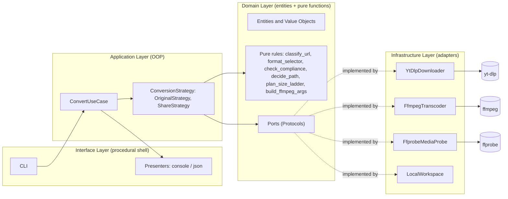
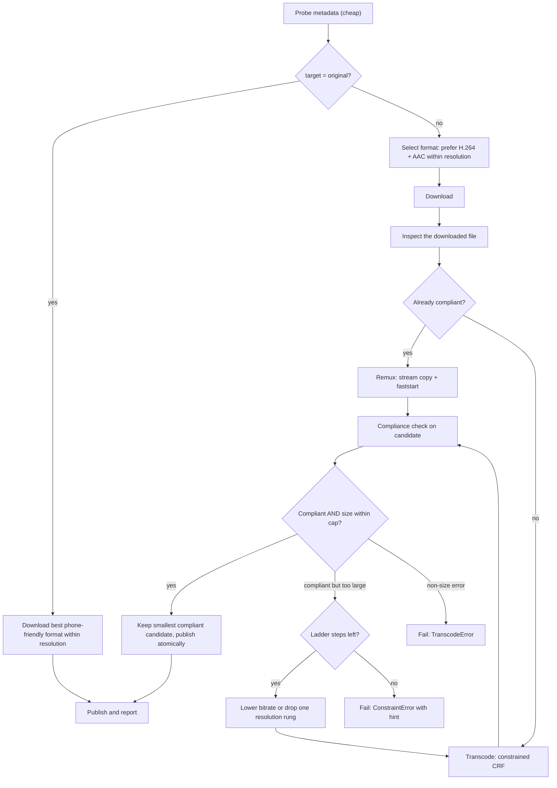
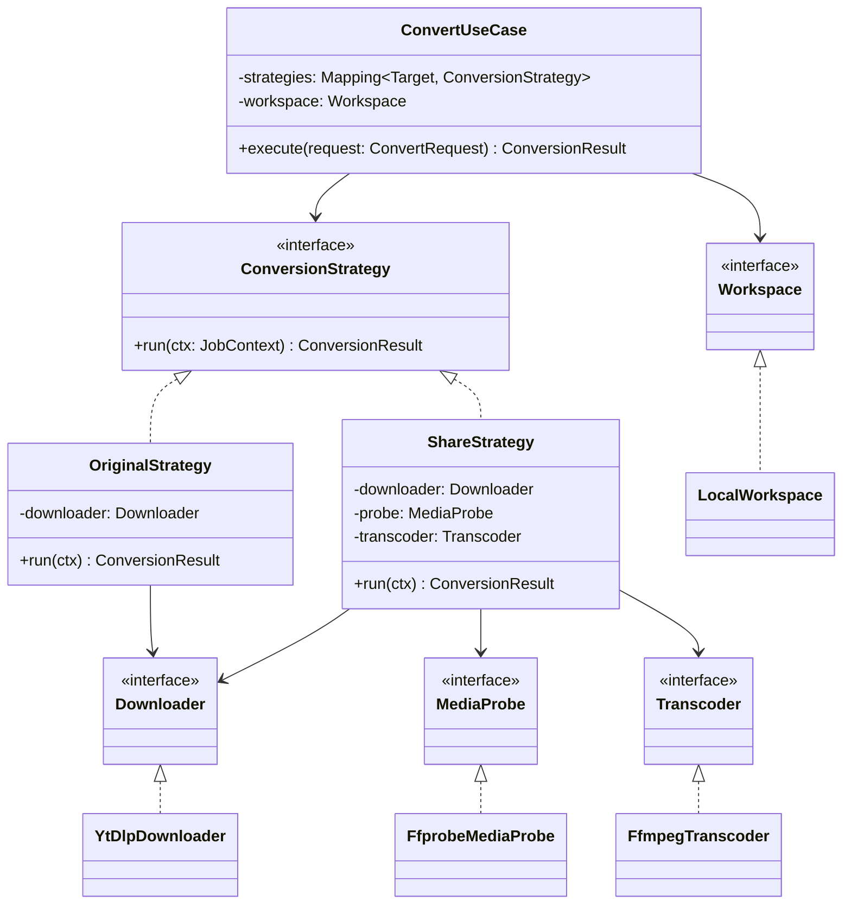

# Architecture

# yt2wa — Architecture Design Document

> **Status:** Draft v0.2 for review 
> **Purpose:** A Python CLI that downloads YouTube videos and Shorts with **yt-dlp** and, when requested, converts them with **ffmpeg** into files that WhatsApp can send as a Status or in chats and groups.
> **Legend:** **[DECISION]** needs your sign-off. **[RISK]** is a known unknown. **[VERIFY]** is a platform number that changes over time and must be re-checked before release.

---

## 0. Change Log and Resolved Decisions

| # | Topic | Resolution (from your review) | Effect on design |
|---|-------|-------------------------------|------------------|
| 1 | Language | **Python** | Use yt-dlp's library API directly. |
| 2 | Community posts | **Deferred** | `post` command, `ExtractPostUseCase`, and image processing removed from v1. Extension seam kept (Section 12). |
| 3 | Videos too long for Status | **WhatsApp trims in its own editor** | Trim/split flags and policies removed. The tool only emits an advisory warning. |
| 4 | Non-vertical videos | **Leave as they are** | No pad/crop. Aspect ratio always preserved. A warning is shown when a Status upload is not 9:16. |
| 5a | File size | Re-encoding does not guarantee a smaller file | New **Size Guard** with candidate selection and a fallback ladder (Section 7). |
| 5b | Codec compatibility | H.264 / AAC-LC / yuv420p / 30 fps / stereo 44.1 or 48 kHz / `+faststart` / rotation handled | New **Compliance Checker** verifying every setting on the *actual output file* (Section 6). |
| 5c | Personal vs shareable output | Need a flag to keep the video as it is | New `--target original \| chat \| status` (Section 5). |
| 5d | Resolution selection | Need a flag, default around 480p | New `--resolution` flag (Section 8). |

**Interpretation notes (please confirm):**
- Supported values: `144, 240, 360, 480, 720, 1080, best`. **[DECISION]**
- Resolution follows YouTube's convention: the number is the **short edge**. So `1080` means 1920×1080 for landscape and 1080×1920 for portrait, and `480` means 854×480 or 480×854.
- The compatibility settings are **recommendations, not a guarantee** that WhatsApp accepts a file. The tool verifies the file against the recommendations and reports pass/fail. It never claims WhatsApp will accept it.

---

## 1. Goals and Non-Goals

### 1.1 Goals
- Download a YouTube video or Short from a URL.
- Offer three output intents (**targets**):
  - `original`: keep the video as downloaded, for personal viewing on your own phone.
  - `chat`: a WhatsApp-compatible file for chats and groups.
  - `status`: a WhatsApp-compatible file tuned for Status (portrait 1080×1920 maximum).
- Let the user choose resolution, with a sensible low default to save data and storage.
- Prove compatibility by inspecting the final file, not by trusting the encoder settings.
- Stay scriptable (exit codes, stdout/stderr discipline, JSON output) and extensible.
- Follow OOP, functional and procedural paradigms where each fits best, plus 12-factor principles.

### 1.2 Non-Goals
- No GUI, no WhatsApp API integration; the user shares the file manually.
- No trimming or splitting (WhatsApp does this).
- No padding, cropping, or aspect-ratio changes.
- No community posts or playlists in v1.
- No DRM circumvention; no cookie scraping by default.

### 1.3 Legal / Policy Note
Downloading may violate YouTube's Terms of Service or copyright law depending on the content and your jurisdiction. The tool prints a one-time notice on first run and recommends use only for content you own, have permission to use, or that is licensed for reuse.

---

## 2. Requirements

### 2.1 Functional

| ID | Requirement |
|----|-------------|
| F1 | Classify URL as `VIDEO` or `SHORT`; reject others (`POST`, `PLAYLIST`, unknown) with a clear message. |
| F2 | Download using yt-dlp's library API, selecting a format whose short edge is ≤ the requested resolution. |
| F3 | `--target original`: produce the downloaded file as-is (see 5.2), with no re-encode. |
| F4 | `--target chat` / `status`: produce an MP4 that satisfies the compatibility profile (Section 6), re-encoding **only if needed**. |
| F5 | Never upscale. If the source is smaller than the requested resolution, keep the source size and say so. |
| F6 | Enforce a size cap for shareable targets using the Size Guard (Section 7). |
| F7 | Verify the final file with a Compliance Checker and print a pass/fail report (`--report`, included in `--json`). |
| F8 | `verify <file>` command: run the Compliance Checker on any existing file. |
| F9 | Progress display for download and transcode. |
| F10 | `doctor` command checks that ffmpeg, ffprobe and yt-dlp exist and meet minimum versions. |
| F11 | `clean` command removes stale temp job directories. |
| F12 | `--dry-run` prints the plan (selected format, decision path, ffmpeg argv) and does nothing. |

### 2.2 Non-Functional

| Category | Requirement |
|----------|-------------|
| Portability | Linux, macOS, Windows. |
| Reliability | Retries on transient network errors; partial files are never reported as success; atomic publish. |
| Performance | Avoid unnecessary work: remux instead of re-encode whenever the source already complies. |
| Observability | Structured logs to stderr; verbosity flags. |
| Testability | Core logic testable without network or ffmpeg installed. |
| Security | argv lists only (no shell strings), sanitized filenames, no secrets in logs. |

---

## 3. Design Philosophy: Where Each Paradigm Is Used

| Paradigm | Used for | Why |
|----------|----------|-----|
| **OOP** | Adapters (`YtDlpDownloader`, `FfmpegTranscoder`, `FfprobeMediaProbe`), the use case, and the **Strategy** hierarchy (`OriginalStrategy`, `ShareStrategy`) | Encapsulates lifecycle (subprocesses, temp dirs, callbacks); polymorphism lets targets and implementations be swapped. |
| **Functional** | Everything deterministic: URL classification, resolution→format selector, compliance checking, remux-vs-transcode decision, bitrate math, size-ladder planning, ffmpeg argv building, filename sanitizing | Pure functions are trivially testable, have no hidden state, and compose well. This is where the compatibility rules live. |
| **Procedural** | CLI entrypoint and composition root: parse → load config → wire → run → map result to exit code | Linear and readable at the edge. |

### 3.1 Principles
- **SOLID.** Single responsibility per module; open/closed via registries and strategies (new target = new strategy + preset, no edits to existing ones); Liskov-substitutable ports (fakes in tests); small interfaces; dependency inversion (application depends on ports).
- **Hexagonal architecture** with one-way dependencies: `interface → application → domain ← infrastructure`.
- **Functional core, imperative shell.**
- **Make illegal states unrepresentable:** frozen dataclasses and enums instead of loose strings and dicts.
- **Verify, don't assume:** the output file is inspected after creation.
- **Fail fast:** validate inputs and the environment before any large download.
- **KISS / YAGNI:** no plugin framework in v1.

---

## 4. High-Level Architecture



---

## 5. Targets (Output Intents)

### 5.1 Overview

| Target | Intent | Re-encode? | Container | Resolution rule | Size cap |
|--------|--------|------------|-----------|-----------------|----------|
| `original` | Watch on my own phone later; not for sharing | **Never** | Whatever yt-dlp produces; MP4 preferred | Short edge ≤ `--resolution` (or `best`) | None |
| `chat` | Send to a person or group | Only if the file isn't already compliant | MP4 | Up to 1920×1080 (landscape) or 1080×1920 (portrait), never upscaled | ≤ 16 MB default  |
| `status` | Post as WhatsApp Status | Only if the file isn't already compliant | MP4 | Up to 1080×1920 portrait; aspect **preserved** | ≤ 16 MB default|

a plain `yt2wa <url>` always produces something shareable. Use `--target original` (alias `--keep-original`) for personal viewing. Alternative: default to `original`.

### 5.2 `original` Target Behavior
"Stays as it is, as long as it plays on my phone":
1. Select a format preferring phone-friendly streams: H.264 video plus AAC audio in MP4 (`avc1` + `m4a`). Selector shape:
   `bv*[vcodec^=avc1][height<=H]+ba[ext=m4a]/b[ext=mp4][height<=H]/bv*[height<=H]+ba/b[height<=H]`
2. yt-dlp merges video and audio streams **without re-encoding** (stream copy into MP4).
3. If only VP9/AV1/Opus streams exist, the container falls back to MKV/WebM. The tool prints a note: *"Plays in most modern players (VLC, MX Player); WhatsApp may not accept this file. Use `--target chat` to share."*
4. No compliance verification is enforced; an informational report is still available via `--report`.

### 5.3 `chat` and `status` Targets
Handled by `ShareStrategy` (Section 7). The two differ only in their preset (maximum box and advisory warnings):

| Setting | `chat` | `status` |
|---------|--------|----------|
| Max box | 1920×1080 (long edge 1920, short edge 1080) | 1080×1920 portrait |
| Aspect | Preserved | Preserved |
| Advisory warnings | Over size cap | Not 9:16; over advisory duration **[VERIFY]**; over size cap |

a landscape video sent as Status will display letterboxed inside WhatsApp. The tool warns but does not alter it.

---

## 6. WhatsApp Compatibility Profile and Compliance Checker

### 6.1 Profile (data, not code; stored in `config/presets.default.toml`)

| Property | Required value | How it's produced | How it's verified |
|----------|----------------|-------------------|-------------------|
| Container | MP4 | `-f mp4` | `format_name` contains `mp4` |
| Video codec | **H.264** | `-c:v libx264` | `codec_name == h264` |
| H.264 profile / level | High, level chosen by size and fps (3.0 up to 480p, 3.1 for 720p, 4.0 for 1080p) | pure `select_h264_level(w, h, fps)` | `profile`, `level` ≤ chosen |
| Pixel format | **yuv420p** | `-pix_fmt yuv420p` | `pix_fmt == yuv420p` |
| Frame rate | **30 fps** (capped; never upconverted) | `fps=30` filter only when source > 30 | `avg_frame_rate` ≤ 30 |
| Resolution (chat) | Up to 1920×1080 | scale-down only | width/height within box |
| Resolution (status) | Up to 1080×1920 portrait | scale-down only | width/height within box |
| Aspect ratio | **Preserved** (9:16 ideal for status) | `scale=-2:H` keeps ratio; even dimensions | display aspect ≈ source aspect (±1%) |
| Orientation | Rotation metadata handled | If source has non-zero rotation, force transcode so rotation is **baked into pixels** and the tag cleared | no rotation side-data / tag |
| Audio codec | **AAC-LC** | `-c:a aac -profile:a aac_low` | `codec_name == aac`, `profile == LC` |
| Audio channels | **Stereo** | `-ac 2` | `channels == 2` |
| Audio sample rate | **44.1 or 48 kHz** | `-ar 48000` (keep 44100 if source is 44100) | `sample_rate ∈ {44100, 48000}` |
| Web optimization | **`+faststart`** | `-movflags +faststart` | `moov` atom precedes `mdat` (pure MP4 box parser) |
| Size | ≤ cap | Size Guard | `size_bytes ≤ cap` |

**[DECISION]** Frame rate: the spec says 30 fps. I propose **cap at 30**, since converting 24/25 fps content up to 30 introduces judder and gains nothing. If you want a strict 30 fps, it's a one-line preset change.

**Silent sources:** if a source has no audio, the output is allowed (no audio track) and the report notes "no audio stream".

### 6.2 Compliance Checker (pure function)

```python
def check_compliance(info: MediaInfo, profile: CompatProfile, size_cap: int | None) -> ComplianceReport
```

- Input is facts from **ffprobe on the actual file** (plus the MP4 atom order for faststart).
- Output is a list of `CheckResult(name, expected, actual, passed, severity)`.
- `severity`: `ERROR` (must fix: codec, pix_fmt, audio, faststart, rotation, size) or `WARNING` (advisory: not 9:16 for status, no audio).
- The same function drives three things:
  1. the **decision** to remux vs. transcode (is the source already compliant?),
  2. the **post-conversion verification**,
  3. the standalone `verify <file>` command.

Reusing one function for all three guarantees the tool's decision and its verification can never disagree.

> **Honest scope:** a passing report means "matches the recommended settings," not "WhatsApp will certainly accept it." Messaging apps may still re-compress or reject files for reasons outside our control. For best quality, share through WhatsApp's **Document** option so it isn't re-compressed (documents have a much larger size limit **[VERIFY]**).

---

## 7. Conversion Pipeline for `chat` / `status` (Size Guard)

### 7.1 The Problem
Re-encoding doesn't guarantee a smaller file. A source already at a low bitrate can grow when re-encoded at a different quality setting, and a high-quality source can still exceed the cap. So the tool must **plan, measure, and choose**, rather than "convert and hope".

### 7.2 Strategy
1. **Select the download format smartly:** prefer H.264/AAC streams at the requested resolution. If available, the source is often already compliant (or nearly), so no quality loss from re-encoding.
2. **Inspect the downloaded file** with ffprobe.
3. **Decide the path** (pure function `decide_path`):
   - **Compliant already** → **remux** (stream copy, `+faststart`). No quality loss, usually smaller than any re-encode.
   - **Not compliant** → **transcode**.
   - **Rotation metadata present** → transcode (bake rotation).
4. **Candidate selection:** produce one or more candidates and keep the **smallest compliant** one. Specifically, if a transcode ends up larger than a compliant remux of the source, the remux wins.
5. **Size ladder:** if the best compliant candidate exceeds the cap, step down through a pure, deterministic plan:

| Attempt | Method |
|---------|--------|
| 1 | Constrained CRF (e.g., CRF 23) with `-maxrate` / `-bufsize` for the target resolution |
| 2 | Target-bitrate encode computed from `cap`, duration, and audio bitrate (with a 5% safety margin) |
| 3 | Step **one resolution rung down** (e.g., 720→480) and repeat attempt 2 |
| 4 | Continue down to a floor (default 360p) |
| 5 | Still too large → fail with `ConstraintError` and a hint |

A **minimum viable video bitrate** table per resolution prevents producing unwatchable output. If the bitrate required to fit the cap falls below that floor, the ladder drops a rung instead of crushing quality.

6. **Verify and publish:** run `check_compliance` on the chosen candidate; publish atomically only if all `ERROR` checks pass.

### 7.3 Decision Flow



### 7.4 Reference ffmpeg Shape (generated by pure `build_ffmpeg_args`, never hand-typed)

```
ffmpeg -hide_banner -y -i <input>
  -vf "scale=-2:<H>:flags=lanczos,fps=30"        # scale only when downscaling; fps only when source > 30
  -c:v libx264 -profile:v high -level <computed> -pix_fmt yuv420p
  -crf 23 -maxrate <computed> -bufsize <computed>
  -c:a aac -profile:a aac_low -b:a 128k -ar 48000 -ac 2
  -movflags +faststart
  <output.mp4>
```

Remux shape: `ffmpeg -i <input> -c copy -movflags +faststart <output.mp4>`

For portrait video the scale expression is `scale=<W>:-2` so the *short edge* is the constrained one, consistent with the resolution convention. Dimensions are always forced even.

---

## 8. Resolution Flag

```
-r, --resolution {144,240,360,480,720,1080,best}     [default: 480]
```

| Rule | Behavior |
|------|----------|
| Meaning | **Short-edge** height, YouTube convention (480 → 854×480 landscape or 480×854 portrait) |
| Download | yt-dlp format selector filters by `min(width, height) ≤ R`, so we never download 4K to shrink it |
| No upscaling | If the best available is below R, use it as-is and print an info note |
| `best` with `original` | Highest quality available |
| `best` with `chat` / `status` | Clamped to 1080 (the profile maximum) |
| Values above 1080 | Not offered for shareable targets |
| Size ladder | May lower the effective resolution if the size cap can't be met; the report records both requested and effective resolution |
| Default | **480** (small, quick, data-friendly), overridable via `YT2WA_DEFAULT_RESOLUTION` |

**[DECISION]** The default 480 applies to **all** targets including `original`. Alternative: `original` defaults to `best`. I'd keep one consistent default and let users pass `-r best`.

---

## 9. Detailed Design

### 9.1 Domain Layer (pure, no I/O)

**Entities / value objects (frozen dataclasses and enums):**

| Type | Notes |
|------|-------|
| `Target` (Enum) | `ORIGINAL`, `CHAT`, `STATUS` |
| `Resolution` (Enum/int) | `P144 … P1080`, `BEST` |
| `SourceKind` (Enum) | `VIDEO`, `SHORT`, `UNSUPPORTED` |
| `SourceRef` | `url, kind, video_id` |
| `StreamFacts` | Per-file facts: `container, vcodec, vprofile, vlevel, pix_fmt, width, height, fps, rotation, acodec, aprofile, channels, sample_rate, size_bytes, duration_s, faststart: bool \| None` |
| `CompatProfile` | Required values from Section 6 plus max box and size cap |
| `ComplianceReport` | `results: list[CheckResult]`, `.ok`, `.errors`, `.warnings` |
| `PathDecision` | `REMUX` or `TRANSCODE` (with `reasons: list[str]`) |
| `LadderStep` | `method, resolution, video_bitrate_k` |
| `Candidate` | `path, report, size_bytes, method` |
| `ConversionResult` | `output, target, requested_res, effective_res, method, report, warnings` |

**Pure functions:**

```
classify_url(url) -> SourceRef
build_format_selector(target, resolution) -> str
select_h264_level(width, height, fps) -> str
check_compliance(facts, profile, size_cap) -> ComplianceReport
decide_path(facts, profile) -> PathDecision
compute_video_bitrate_k(cap_bytes, duration_s, audio_k, safety=0.95) -> int
plan_size_ladder(facts, profile, cap_bytes, requested_res) -> list[LadderStep]
choose_best_candidate(candidates) -> Candidate | None      # smallest with report.ok
build_ffmpeg_args(plan) -> list[str]
parse_mp4_atom_order(header_bytes) -> bool                 # faststart detection
sanitize_filename(title, max_len=80) -> str
map_exception_to_exit_code(exc) -> int
```

**Ports (`typing.Protocol`):**

```python
class Downloader(Protocol):
    def probe(self, ref: SourceRef) -> SourceMetadata: ...
    def download(self, ref: SourceRef, selector: str, dest: Path,
                 on_progress: ProgressCallback) -> Path: ...

class Transcoder(Protocol):
    def run(self, args: list[str], duration_s: float,
            on_progress: ProgressCallback) -> None: ...

class MediaProbe(Protocol):
    def inspect(self, path: Path) -> StreamFacts: ...

class Workspace(Protocol):
    def new_job_dir(self) -> Path: ...
    def publish(self, src: Path, final_name: str) -> Path: ...
    def cleanup(self, job_dir: Path) -> None: ...
```

### 9.2 Application Layer (OOP: Strategy + Use Case)



`ConvertUseCase.execute`:
1. `classify_url` → reject unsupported kinds immediately.
2. `downloader.probe` → metadata only (fails fast on private/removed/geo-blocked).
3. Create a job directory; build `JobContext` (request, profile, size cap).
4. Delegate to the strategy selected by `request.target`.
5. `finally`: clean up the job directory (also invoked by the signal handler).

`ShareStrategy.run` implements Section 7 step by step (template-method style, each step a small private method, all decisions delegated to pure functions).

### 9.3 Infrastructure Layer

| Adapter | Responsibility |
|---------|----------------|
| `YtDlpDownloader` | Wraps `yt_dlp.YoutubeDL`; `noplaylist=True`; progress hooks; maps yt-dlp errors to domain errors (`PrivateVideo`, `GeoBlocked`, `AgeRestricted`, `NetworkError`); bounded retries with backoff. |
| `FfmpegTranscoder` | Runs ffmpeg via `subprocess.Popen` with an **argv list** (never `shell=True`); parses `-progress pipe:1`; terminates the process group on cancel. |
| `FfprobeMediaProbe` | Runs `ffprobe -print_format json -show_streams -show_format`, reads rotation from stream tags and side data, reads the first bytes of the file for the faststart check, returns `StreamFacts`. |
| `LocalWorkspace` | Job directories under `YT2WA_WORK_DIR`; atomic publish via `os.replace`; cleanup. |

### 9.4 Interface Layer (procedural shell)

```python
def main(argv: list[str] | None = None) -> int:
    args = parse_args(argv)
    settings = load_settings()                 # env config (12-factor III)
    configure_logging(settings, args.verbose)
    container = build_container(settings)      # composition root
    install_signal_handlers(container)
    try:
        result = container.convert.execute(to_request(args))
        render(result, as_json=args.json, show_report=args.report)
        return ExitCode.OK
    except DomainError as exc:
        render_error(exc, as_json=args.json)
        return map_exception_to_exit_code(exc)
```

### 9.5 Error Hierarchy

```
DomainError
├── UsageError
├── UnsupportedSourceError          (posts, playlists, non-YouTube)
├── SourceUnavailableError          (Private, Removed, GeoBlocked, AgeRestricted)
├── NetworkError
├── DependencyError                 (MissingBinary, VersionTooOld)
├── TranscodeError
└── ConstraintError                 (CannotMeetSizeCap, NonCompliantOutput)
```

Adapters translate third-party exceptions at the boundary. Every error carries an actionable `hint`.

---

## 10. CLI Specification

```
yt2wa [convert] <url> [options]
yt2wa verify <file> [--target chat|status] [--json]
yt2wa doctor
yt2wa clean

convert options:
  -t, --target {original,chat,status}   Output intent                    [default: chat]
      --keep-original                   Alias for --target original
  -r, --resolution {144,240,360,480,720,1080,best}                       [default: 480]
  -o, --output-dir PATH                 Where to save the result         [default: ./out]
      --max-size MB                     Override size cap (chat/status)  [default: 16]
      --report                          Print the compliance report
      --keep-source                     Keep the downloaded source file
      --json                            Machine-readable output
      --dry-run                         Show the plan and ffmpeg argv only
  -v / -vv / -q                         Verbosity
```

**Example invocations**

| Goal | Command |
|------|---------|
| Watch later on my phone, best quality | `yt2wa <url> --keep-original -r best` |
| Send to a group at default quality | `yt2wa <url>` |
| Post as Status in 720p | `yt2wa <url> -t status -r 720` |
| Check any file against the profile | `yt2wa verify clip.mp4 -t status` |

**Exit codes**

| Code | Meaning |
|------|---------|
| 0 | Success (for chat/status: all ERROR checks passed) |
| 2 | Invalid usage |
| 3 | Unsupported URL kind |
| 4 | Source unavailable (private, removed, geo-blocked, age-gated) |
| 5 | Network failure after retries |
| 6 | Missing or incompatible dependency |
| 7 | Transcode failed |
| 8 | Could not satisfy constraints (size cap or compliance) |
| 130 | Interrupted |

**Stream discipline:** results (path or JSON) go to **stdout**; logs, progress and errors go to **stderr**.

**Advisory output example (stderr):**
```
✔ Saved: out/My_Clip_480p.mp4  (7.9 MB, remuxed, no re-encode)
✔ Compliance: 11/11 checks passed
⚠ Video is 16:9. Status works best at 9:16; WhatsApp will letterbox it.
ℹ WhatsApp may still re-compress media. Send as Document for original quality.
```

---

## 11. Folder Structure

```
yt2wa/
├── pyproject.toml                  # Metadata, declared deps, entry point
├── uv.lock                         # Locked, reproducible dependency set
├── README.md
├── LICENSE
├── Dockerfile                      # Multi-stage; bundles ffmpeg + pinned yt-dlp
├── docker-compose.yml
├── Makefile
├── .env.example                    # Documented env vars (no secrets)
├── .gitignore
├── .pre-commit-config.yaml
│
├── config/
│   └── presets.default.toml        # CompatProfile data: chat, status, ladder floors
│
├── docs/
│   ├── architecture.md             # This document
│   ├── adr/
│   │   ├── 0001-python-and-ytdlp-library-api.md
│   │   ├── 0002-hexagonal-architecture.md
│   │   ├── 0003-profile-as-data.md
│   │   └── 0004-verify-output-not-settings.md
│   └── whatsapp-constraints.md     # Limits + last-verified date [VERIFY]
│
├── src/
│   └── yt2wa/
│       ├── __init__.py
│       ├── __main__.py
│       │
│       ├── domain/                 # Pure: no I/O, no third-party imports
│       │   ├── models.py           # Dataclasses, enums
│       │   ├── errors.py
│       │   ├── ports.py            # Downloader, Transcoder, MediaProbe, Workspace
│       │   ├── url_rules.py        # classify_url
│       │   ├── formats.py          # build_format_selector, resolution rules
│       │   ├── profile.py          # CompatProfile, loading and validation
│       │   ├── compliance.py       # check_compliance, ComplianceReport
│       │   ├── decision.py         # decide_path, choose_best_candidate
│       │   ├── size_guard.py       # compute_video_bitrate_k, plan_size_ladder
│       │   ├── ffmpeg_args.py      # build_ffmpeg_args, select_h264_level
│       │   └── mp4_atoms.py        # parse_mp4_atom_order (faststart check)
│       │
│       ├── application/
│       │   ├── dto.py              # ConvertRequest, JobContext
│       │   ├── convert.py          # ConvertUseCase
│       │   ├── verify.py           # VerifyUseCase
│       │   └── strategies/
│       │       ├── base.py         # ConversionStrategy (interface)
│       │       ├── original.py     # OriginalStrategy
│       │       └── share.py        # ShareStrategy (Size Guard pipeline)
│       │
│       ├── infrastructure/
│       │   ├── ytdlp_downloader.py
│       │   ├── ffmpeg_transcoder.py
│       │   ├── ffprobe_probe.py
│       │   ├── local_workspace.py
│       │   └── process.py          # Safe subprocess runner, signal handling
│       │
│       ├── interface/
│       │   ├── cli.py
│       │   ├── presenters.py       # Console and JSON; compliance report rendering
│       │   ├── progress.py
│       │   └── exit_codes.py
│       │
│       ├── bootstrap/              # Composition root
│       │   ├── settings.py         # Typed env-based config
│       │   ├── container.py
│       │   └── logging_setup.py
│       │
│       └── py.typed
│
├── tests/
│   ├── unit/
│   │   ├── domain/                 # compliance, decision, size_guard, ffmpeg_args, formats
│   │   └── application/            # strategies with fakes
│   ├── integration/                # Real ffmpeg on tiny fixtures; ffprobe-verified output
│   ├── contract/                   # Adapters satisfy port contracts
│   ├── e2e/                        # Network-gated (@network)
│   ├── fakes/
│   └── fixtures/
│       ├── h264_aac_compliant.mp4
│       ├── vp9_opus.webm
│       ├── rotated_90.mp4
│       ├── moov_at_end.mp4
│       ├── mono_22khz.mp4
│       └── high_bitrate_1080p.mp4
│
├── scripts/
│   ├── release.sh
│   └── check_whatsapp_limits.py
│
└── .github/workflows/
    ├── ci.yml
    └── release.yml
```

**Import rules** (enforced in CI with `import-linter`): `domain` imports nothing from other layers; `application` imports `domain` only; `infrastructure` imports `domain` and third-party libs; `interface` and `bootstrap` may import everything and nothing imports them.

---

## 12. Twelve-Factor Mapping (CLI-Adapted)

| # | Factor | Application in yt2wa |
|---|--------|----------------------|
| I | Codebase | One repo, many deploys (dev, CI, Docker, pipx) from tagged commits. |
| II | Dependencies | Python deps declared in `pyproject.toml`, locked in `uv.lock`. ffmpeg/ffprobe are declared, checked by `doctor`, and bundled in the Docker image. |
| III | Config | Environment variables with the `YT2WA_` prefix; compatibility profile is a data file; no secrets in code. CLI flags override env for one-off runs. |
| IV | Backing services | yt-dlp, ffmpeg and ffprobe are attached resources behind ports; paths come from config. |
| V | Build, release, run | CI builds the wheel and Docker image; releases are immutable and version-tagged; runtime only reads config. |
| VI | Processes | Stateless, share-nothing; each run uses an isolated job directory; the only durable output is the published file. |
| VII | Port binding | Not applicable to a CLI. Noted explicitly. |
| VIII | Concurrency | Scale by running multiple processes; unique job dirs make parallel runs safe; ffmpeg threads configurable. |
| IX | Disposability | Fast startup; SIGINT/SIGTERM stop child processes and delete partials; atomic publish prevents half-written outputs. |
| X | Dev/prod parity | Same Docker image everywhere; pinned ffmpeg; integration tests run the real ffmpeg in CI. |
| XI | Logs | Event stream on stderr; `text` or `json` format; results only on stdout. |
| XII | Admin processes | `doctor`, `clean`, `verify` ship in the same codebase and environment. |

### 12.1 Environment Variables

| Variable | Default | Purpose |
|----------|---------|---------|
| `YT2WA_DEFAULT_TARGET` | `chat` | Target when `--target` is omitted |
| `YT2WA_DEFAULT_RESOLUTION` | `480` | Resolution when `-r` is omitted |
| `YT2WA_MAX_SIZE_MB` | `16` | Size cap for chat/status **[VERIFY]** |
| `YT2WA_MIN_RESOLUTION_FLOOR` | `360` | Lowest rung the Size Guard may drop to |
| `YT2WA_PROFILE_FILE` | built-in | Path to a custom compatibility profile TOML |
| `YT2WA_WORK_DIR` | system temp | Scratch space |
| `YT2WA_OUTPUT_DIR` | `./out` | Default output location |
| `YT2WA_FFMPEG_BIN` / `YT2WA_FFPROBE_BIN` | `ffmpeg` / `ffprobe` | Binary paths |
| `YT2WA_FFMPEG_THREADS` | `0` (auto) | ffmpeg threads |
| `YT2WA_NET_RETRIES` | `3` | Download retries |
| `YT2WA_COOKIES_FILE` | unset | Optional cookies for age-gated content (opt-in) |
| `YT2WA_LOG_LEVEL` / `YT2WA_LOG_FORMAT` | `INFO` / `text` | Logging |

**Precedence:** CLI flag > environment > `.env` (dev only) > built-in default.

---

## 13. Testing Strategy

| Level | Scope | Tools |
|-------|-------|-------|
| Unit (domain) | `check_compliance` against every fixture permutation (wrong codec, pix_fmt, mono audio, 22 kHz, rotation, moov-at-end, oversize); `decide_path`; `plan_size_ladder`; `build_format_selector`; `build_ffmpeg_args` | `pytest`, `hypothesis` for bitrate/ladder invariants |
| Unit (application) | Strategies with fakes: remux wins over a larger transcode; ladder steps down and terminates; failure paths | `pytest` |
| Contract | Real and fake adapters satisfy the same port tests | `pytest` parametrized |
| Integration | Real ffmpeg on tiny fixtures; **run `check_compliance` on the real output** | CI Docker image |
| E2E (opt-in) | A Creative Commons video, all three targets | `@network` marker |
| Static | Types, lint, import boundaries | `mypy --strict`, `ruff`, `import-linter` |

**Key invariants (property tests):**
- The ladder is strictly decreasing and always terminates.
- `choose_best_candidate` never returns a non-compliant candidate.
- The output resolution never exceeds the source or the requested resolution (no upscaling).
- If the source is already compliant and within the cap, the chosen method is `REMUX`.

**Golden test:** snapshot the ffmpeg argv per profile and resolution to catch accidental encoding-setting changes.

---

## 14. Security and Robustness

- argv lists only; URLs go to yt-dlp's API, never into shell strings.
- Sanitized filenames; output confined to the configured output directory; Windows reserved names handled.
- Configurable limits on source duration and download size to protect disk space.
- yt-dlp pinned with a documented upgrade routine, since YouTube changes frequently break extractors; `doctor` reports yt-dlp age; a scheduled CI canary tests a stable video.
- Cookies are opt-in, never logged, never copied into job directories.
- Lockfile, hash-verified installs, `pip-audit` in CI.

---

## 15. Deferred Work and Extension Seams

| Item | Seam already in place |
|------|-----------------------|
| Community posts | New `PostStrategy` plus a `download_post` method on a new `PostDownloader` port; `classify_url` already returns a distinct kind (currently rejected with exit code 3). |
| Trim / split | Would be a new pre-step producing a `TimeRange` list consumed by `build_ffmpeg_args`; intentionally excluded because WhatsApp trims in-app. |
| Hardware encoders | `build_ffmpeg_args` takes an encoder descriptor; add `YT2WA_HW_ACCEL`. |
| Batch / playlists | `ConvertUseCase` is stateless, so a worker pool can wrap it. |
| Auto Document hint | Presenter already prints the advisory; could add a "copy path to clipboard" helper. |

---

## 16. Phased Roadmap

| Phase | Scope |
|-------|-------|
| **M0** | Skeleton, settings, logging, `doctor`; domain models; `check_compliance`, `mp4_atoms`, `build_format_selector` with full unit tests |
| **M1** | `OriginalStrategy` end to end (`--target original`, `-r`) |
| **M2** | `ShareStrategy`: remux/transcode decision, ffmpeg adapter, post-verification, `verify` command, `--report` |
| **M3** | Size Guard ladder, candidate selection, `--dry-run`, `clean` |
| **M4** | Docker image, CI matrix, release pipeline, JSON output polish |

---

## 17. Remaining Open Questions

1. **Default target:** `chat` (proposed) or `original`? **[DECISION]**
2. **Resolution interpretation:** confirm 420→480 and 760→720, and short-edge convention. **[DECISION]**
3. **Default resolution for `original`:** same 480 default (proposed) or `best`? **[DECISION]**
4. **Frame rate:** cap at 30 (proposed) or force exactly 30? **[DECISION]**
5. **Size cap default:** 16 MB, and the resolution floor of 360p for the ladder. **[VERIFY]** against current WhatsApp behavior.
6. **Failure behavior when the cap can't be met:** fail (proposed), or deliver the best-effort file with an `ERROR`-level warning and a non-zero exit code?
7. **Advisory duration for Status:** warn above what value? **[VERIFY]**

---

## 18. Glossary

- **Port / Adapter:** the abstract interface the application needs, and its concrete implementation.
- **Composition root:** the single place where concrete objects are created and wired.
- **Remux:** repackaging streams into a new container without re-encoding (fast, lossless).
- **Faststart:** moving the MP4 `moov` index to the file start so playback can begin before the full file is read.
- **Size Guard:** the plan-measure-choose pipeline that handles the fact that re-encoding doesn't guarantee a smaller file.
- **Compliance Checker:** the pure function that compares real file facts to the compatibility profile.
