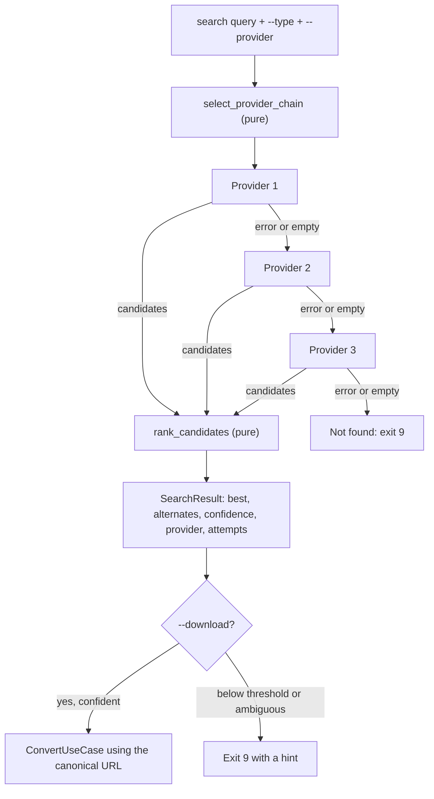

# yt2wa — Architecture Addendum v0.3

> **Status:** Design for review. **No code changes until this is approved.**
> **Revision:** still v0.3. Search now supports three methods (`ytsearch`, YouTube Music URL, `ytmusicapi`) behind one port, with a selection and fallback policy (ADR-0008, ADR-0012, ADR-0013).
> **Builds on:** `yt2wa-architecture.md` (v0.2) and the code generated by `setup_yt2wa.sh`.
> **How to read this:** v0.2 is not rewritten. This addendum only records what is *new or changed*. Anything not mentioned here stays as v0.2 describes it (layers, 12-factor mapping, targets, Size Guard, compliance checker, folder rules).
> **Legend:** **[DECISION]** needs your sign-off. **[RISK]** is a known unknown. **[VERIFY]** must be checked against the live service before release.

---

## 1. Scope

### 1.1 In scope for v0.3
1. **Audio download.** An option on `convert` to get audio only from a YouTube video, either as-is or as a WhatsApp-friendly audio file.
2. **Search.** A new `search` command that finds videos or music on YouTube and returns the metadata of the **most likely match**, with alternates and a confidence score. Three interchangeable search methods are supported (section 4.5).
3. **Search then download.** An optional flag that feeds the best match straight into the existing convert pipeline.

### 1.2 Out of scope (explicitly dropped)
- Facebook, Instagram, Spotify and Apify integrations, including image and story extraction. These are not designed here.
- Spotify or any streaming-service lookups. Metadata comes from YouTube only.
- Playlists, album download, lyrics, voice-message (push-to-talk) formatting.
- Authenticated YouTube Music features (library, uploads, playlist editing, history). Search is unauthenticated only.
- Embedding cover art (see ADR-0009).
- Implicit search: `convert` never treats plain text as a search query.

---

## 2. Architecture Decision Records

Numbering continues from the four ADRs in v0.2 (`docs/adr/0001`–`0004`).

### ADR-0005 — Audio is a media kind, not a new target

- **Context.** Targets (`original`, `chat`, `status`) describe *what the file is for*. Audio vs video describes *what the file contains*. They are independent.
- **Decision.** Add a `MediaKind` enum (`VIDEO`, `AUDIO`) and a `--audio` flag (short form `-x`). Targets stay as they are.
- **Behavior by target:**

| Target | With `--audio` |
|--------|----------------|
| `original` | Download the best audio stream as it is. No re-encode. Usually M4A (AAC) or WebM (Opus). |
| `chat` | Produce a WhatsApp-friendly audio file (default: M4A, AAC-LC). Remux if the source already complies, otherwise transcode. |
| `status` | **Rejected** with a usage error (exit 2). Status needs a picture. Hint: use `chat`, or download the video. |

- **Consequences.** Strategy lookup key changes from `Target` to `(MediaKind, Target)`. Existing video strategies are untouched (Open/Closed).
- **Alternatives rejected.** A fourth target `audio`: mixes two concepts and breaks the `chat` + `status` symmetry.

### ADR-0006 — Audio compliance is its own pure function and profile

- **Context.** v0.2's `check_compliance` assumes a video stream. Reusing it for audio would add conditionals everywhere.
- **Decision.** Add an `AudioProfile` (data, like the video profile) and a sibling pure function `check_audio_compliance`. The remux-vs-transcode decision, candidate choice and verification all reuse the same pattern as v0.2: one function decides, verifies and powers `verify`.
- **Audio profile defaults** **[VERIFY against WhatsApp]**:

| Property | Required value |
|----------|----------------|
| Container | M4A (MP4 audio) with `+faststart`, or MP3 when `--audio-format mp3` |
| Codec | AAC-LC (M4A) or MP3 |
| Channels | Mono or stereo (never more than 2) |
| Sample rate | 44.1 or 48 kHz |
| Bitrate | Up to 128 kbit/s by default (`--audio-bitrate`) |
| Size cap | Same media cap as video (16 MB default) |

- **Consequences.** `StreamFacts` gains one field, `abitrate_k`, read from ffprobe. The `verify` command picks the audio or video checker from the file's streams.

### ADR-0007 — Audio Size Guard is a bitrate-only ladder

- **Context.** A one hour talk at 128 kbit/s is about 57 MB, well over the cap. Re-encoding does not always help (same lesson as v0.2).
- **Decision.** Reuse the "plan, measure, choose" idea with an audio-specific pure planner `plan_audio_ladder(duration, cap, steps)`. Default steps: 128, 96, 64 kbit/s. There is no resolution to drop. If 64 kbit/s still exceeds the cap, fail with `SizeCapError` and the same hint (send as a Document, or raise `--max-size`).
- **Consequences.** A minimum viable audio bitrate (default 48 kbit/s) stops unlistenable output.

### ADR-0008 — Search is a port with three interchangeable providers

- **Context.** We need YouTube search without a paid or key-based API (12-factor: avoid secrets and quotas where possible). Three methods are available, each with different strengths.
- **Decision.** One port, `SearchProvider`, with three adapters:

| # | Provider name | How it searches | Strengths | Weaknesses |
|---|---------------|-----------------|-----------|------------|
| 1 | `ytsearch` | yt-dlp with the `ytsearchN:<query>` prefix and flat extraction (one request, no per-result page fetch). `N` is always passed explicitly. | Already a dependency. Works for any video. Simple and fast. | Regular YouTube ranking. No music structure (no album or track fields). Covers, lyric videos and loops can rank high. |
| 2 | `ytmusic-url` | yt-dlp on the YouTube Music search page URL, `https://music.youtube.com/search?q=<url-encoded query>`, built by a pure function. | Music oriented results. No new dependency. | Extracts a web page, so it may return several versions or tracks of the same song. Fewer metadata fields. Depends on yt-dlp's support for that page **[VERIFY with the pinned yt-dlp]**. |
| 3 | `ytmusicapi` | The `ytmusicapi` library, unauthenticated: `YTMusic().search(query, filter=..., limit=N)`. It returns a `videoId`, which is then downloaded with yt-dlp like any other video. | Structured results: result type (song or video), artists, album, duration, video type. Best input for ranking. Has filters. | New third-party dependency. Unofficial: it emulates the YouTube Music web client, so it can break when YouTube changes. Needs Python 3.10 or newer (we require 3.11). |

- **Rules that apply to every provider:**
  - A provider returns **candidates only** (ids and metadata). Downloading always goes through the existing yt-dlp downloader.
  - The adapter outputs a canonical URL, `https://www.youtube.com/watch?v=<id>`, whatever page the result came from.
  - Entries without a video id (artists, albums, playlists in `ytmusicapi` or music page results) are skipped by the adapter.
  - The first result is **never** taken blindly. Every provider's list goes through the ranker (ADR-0010).
  - Adapters map third-party values to domain types, so the domain never sees a library specific string (see `CandidateOrigin`, section 3).
  - Queries are cleaned (control characters removed, length capped, `--limit` capped at 25) before any provider sees them. Providers are called through libraries, never a shell.
- **Consequences.** `doctor` already covers yt-dlp freshness. The YouTube Data API remains a possible later fourth adapter behind the same port.
- **Alternatives rejected.** YouTube Data API now: needs an API key and has quotas. Scraping HTML ourselves: fragile and rude.

### ADR-0009 — Embed basic tags, defer cover art

- **Decision.** For audio output, write `title`, `artist` and `album` (when known) into the file with ffmpeg `-metadata`. Cover art is deferred: it needs an extra download and image handling, and adds failure modes.
- **Consequences.** File names become `Artist - Title.m4a` when the artist is known, else the sanitized title.

### ADR-0010 — "Most likely" is a pure, deterministic ranking function

- **Context.** The search engine's own order is not the same as "the song or video the user meant" (covers, lyric videos, 10-hour loops often rank high).
- **Decision.** A pure function `rank_candidates(query, candidates, kind)` returns scored candidates plus a confidence and an ambiguity flag. No network, no randomness, so it is fully unit-testable with recorded candidate lists. Full spec in section 5.
- **Consequences.** Weights live in code constants first, with a TOML override later (same idea as profiles).
- **Alternatives rejected.** Asking an LLM or an online service to judge: non-deterministic, needs a key, not testable offline.

### ADR-0011 — Search never downloads implicitly

- **Decision.** `search` only returns metadata. Downloading needs an explicit `--download` flag, and is refused when confidence is below `--min-confidence` (default 0.6) or the result is ambiguous, unless the user picks one with `--pick N`. No interactive prompts, so it stays scriptable.
- **Consequences.** Exit code 9 (`NOT_FOUND`) is added for "no result" and "not confident enough".

### ADR-0012 — Provider selection and a fallback chain

- **Context.** No single provider is best for every query, and any of them can fail.
- **Decision.** The CLI gets `--provider {auto,ytsearch,ytmusic-url,ytmusicapi}`, default `auto`. In `auto` mode a **chain** of providers is tried in order, chosen by `--type`:

| `--type` | Chain in `auto` mode |
|----------|----------------------|
| `video` | `ytsearch` |
| `music` | `ytmusicapi` then `ytmusic-url` then `ytsearch` |
| `any` (default) | `ytsearch` |

- **Rules:**
  - An explicit `--provider X` uses only X, with **no fallback**. This makes behavior predictable and testable. If X needs a missing dependency, that is an error.
  - The chain moves to the next provider when the current one **fails** or returns **no candidates**. It does *not* move on because of low confidence; judging relevance is the ranker's job.
  - In `auto` mode a provider whose optional dependency is not installed is skipped (debug log), not an error.
  - `--limit` applies per provider. Candidates from different providers are **not merged** in v0.3, because merging needs de-duplication and a fair position prior across lists.
  - The result records which provider answered and the outcome of each attempt (ok, empty, error, skipped). It is shown with `-v` and always present in `--json`.
- **Design.** A pure function `select_provider_chain(kind, requested, available)` decides the order. `ChainedSearchProvider` (application layer) implements the `SearchProvider` port by running that order over the real adapters (Chain of Responsibility). `SearchUseCase` does not know a chain exists.
- **Consequences.** Exit code 9 (`NOT_FOUND`) is returned only after the whole chain was tried.

### ADR-0013 — `ytmusicapi` is an optional extra, used unauthenticated

- **Context.** `ytmusicapi` gives the best music results but adds a dependency and an unofficial API surface.
- **Decision.**
  - Packaging: `pip install "yt2wa[music]"`, declared as an optional dependency group in `pyproject.toml`. The version range is chosen at implementation time **[VERIFY]**, and `pip-audit` covers it.
  - Loading: imported lazily inside the adapter, the same way yt-dlp is, so startup stays fast and the domain stays free of it.
  - Scope: **search only, unauthenticated.** No OAuth or cookie file is read or written, and no library, upload, playlist or history features are used. This keeps v0.3 free of new secrets (12-factor III).
  - `doctor` reports whether `ytmusicapi` is installed. Absent is **not** a failure.
  - Errors from the library are translated to our domain errors at the boundary (network problems to `NetworkError`, unexpected response shapes to `SourceUnavailableError` with an upgrade hint).
- **Consequences.** Without the extra, `--type music` still works through `ytmusic-url` and `ytsearch`, with less precise results.
- **Assumption to check.** That unauthenticated search needs no cookies or login in practice **[VERIFY]**.

---

## 3. Domain Model Changes

All additions are immutable dataclasses or enums in `domain/models.py` unless noted.

| Type | Change | Notes |
|------|--------|-------|
| `MediaKind` | **new** enum | `VIDEO`, `AUDIO` |
| `SearchKind` | **new** enum | `ANY`, `VIDEO`, `MUSIC` |
| `AudioFormat` | **new** enum | `M4A`, `MP3` |
| `StreamFacts` | add field | `abitrate_k: int \| None` |
| `SourceMetadata` | add optional fields | `artist`, `track`, `album`, `thumbnail_url`, `view_count`, `upload_date` (all default `None`, so v0.2 code keeps working) |
| `SearchProviderName` | **new** enum | `YTSEARCH`, `YTMUSIC_URL`, `YTMUSICAPI` |
| `CandidateOrigin` | **new** enum | `MUSIC_TRACK`, `OFFICIAL_VIDEO`, `USER_UPLOAD`, `UNKNOWN`. Set by each adapter from its own signals (for example a `ytmusicapi` song result, an official video type, or a " - Topic" channel), so the ranker never sees library strings |
| `SearchCandidate` | **new** | `video_id, url` (canonical), `title, channel, duration_s, view_count, position, origin: CandidateOrigin, artists: tuple[str, ...], album: str \| None, provider: SearchProviderName` |
| `ProviderAttempt` | **new** | `provider, outcome` (`ok`, `empty`, `error`, `skipped`), `detail` |
| `ScoredCandidate` | **new** | `candidate, score, reasons: tuple[str, ...]`, plus parsed `artist` and `track` |
| `SearchResult` | **new** | `query, best, alternates, confidence, ambiguous, provider` (the one that answered), `attempts: tuple[ProviderAttempt, ...]` |
| `AudioProfile` | **new** in `domain/audio_profile.py` | formats, allowed sample rates, default and ladder bitrates, size cap, minimum bitrate |
| `ConvertRequest` (application) | add fields | `media: MediaKind`, `audio_format: AudioFormat`, `audio_bitrate_k: int \| None` |
| `SearchRequest` (application) | **new** | `query, kind, limit, provider: SearchProviderName \| None` (None means auto), `detail, min_confidence, download: ConvertRequest \| None, pick: int \| None` |

### 3.1 New pure functions (domain)

```
check_audio_compliance(facts, audio_profile, size_cap_bytes) -> ComplianceReport
decide_audio_path(report) -> PathDecision            # REMUX or TRANSCODE
plan_audio_ladder(duration_s, cap_bytes, steps, min_k) -> tuple[AudioStep, ...]
build_audio_format_selector(audio_format) -> FormatChoice
build_audio_ffmpeg_args(plan) -> list[str]           # tags, -vn, faststart
parse_artist_title(raw_title, channel) -> tuple[str | None, str]
normalize_text(text) -> str                          # lowercase, fold accents, strip noise
build_music_search_url(query) -> str                 # https://music.youtube.com/search?q=<encoded>
clean_query(query, max_len=200) -> str               # strip control characters, cap length
select_provider_chain(kind, requested, available) -> tuple[SearchProviderName, ...]
rank_candidates(query, candidates, kind) -> SearchResult
```

`normalize_text` and `parse_artist_title` are shared by ranking and by audio file naming.

---

## 4. Port and Layer Changes

### 4.1 New port (`domain/ports.py`)

```python
class SearchProvider(Protocol):
    def search(self, query: str, kind: SearchKind, limit: int) -> list[SearchCandidate]: ...
```

Existing ports are unchanged. `Downloader.probe` returns the richer `SourceMetadata` (new optional fields). That is how `--detail` gets album, track and artist for the top hit without a new port method.

### 4.2 Application layer

| Component | Role |
|-----------|------|
| `SearchUseCase` | Calls `SearchProvider`, runs `rank_candidates`, optionally enriches the best hit via `Downloader.probe` (`--detail`), optionally hands the chosen URL to `ConvertUseCase` (`--download`). |
| `AudioOriginalStrategy` | Downloads the best audio stream as is. Mirrors `OriginalStrategy`. |
| `AudioShareStrategy` | Download, inspect, decide remux or transcode, run the audio ladder, verify. Mirrors `ShareStrategy`. |
| `ConvertUseCase` | Strategy map keyed by `(MediaKind, Target)`. Rejects `(AUDIO, STATUS)` early. |
| `VerifyUseCase` | Chooses audio or video checker based on the file's streams. |

### 4.3 Infrastructure layer

| Component | Role |
|-----------|------|
| `YtDlpSearchProvider` | One class, two modes. Mode `ytsearch` calls yt-dlp with `ytsearchN:<query>`. Mode `ytmusic-url` calls it on the URL from `build_music_search_url`. Both use flat extraction, translate entries to `SearchCandidate`, skip entries without an id, and reuse the existing error translation. |
| `YtMusicApiSearchProvider` | Lazy-imports `ytmusicapi`, runs an unauthenticated `search` with the `songs` or `videos` filter, converts `"3:42"`-style durations, maps result and video types to `CandidateOrigin`, skips entries without a `videoId`. |
| `YtDlpDownloader` | Gains no new method. It receives the audio `FormatChoice` (`ba[ext=m4a]/ba`, sorted by `acodec:aac` then bitrate). |
| `FfmpegTranscoder`, `FfprobeMediaProbe` | Unchanged. The probe also reads the audio `bit_rate`. |

### 4.4 Interface layer

New `search` subcommand, new flags on `convert`, a search presenter in console and JSON forms. The dependency rule (`interface → application → domain ← infrastructure`) is unchanged and still enforced by import-linter.

### 4.5 Search methods and the provider chain



| Method | Name on the CLI | Needs | Best for |
|--------|-----------------|-------|----------|
| Standard YouTube search | `ytsearch` | yt-dlp (already installed) | Videos; the default fallback for everything |
| YouTube Music page URL | `ytmusic-url` | yt-dlp (already installed) | Music when `ytmusicapi` is not installed |
| `ytmusicapi` | `ytmusicapi` | `pip install "yt2wa[music]"` | Songs; the richest metadata and the best ranking input |

All three end the same way: a `videoId` goes to yt-dlp for download. Only the discovery step differs.

---

## 5. Ranking Specification ("most likely")

### 5.1 Inputs and normalization
- `normalize_text`: lowercase, fold accents, drop punctuation, then remove **noise words** that carry no identity: *official, video, audio, music, hd, 4k, lyric, lyrics, visualizer, ft, feat, featuring, topic*.
- Tokenize the query and each title and channel the same way.
- `parse_artist_title`: split titles shaped like `Artist - Title`, strip bracketed suffixes such as `(Official Video)`, and fall back to the channel name (minus " - Topic" or "VEVO") as the artist.

### 5.2 Score (0 to 1)

`score = Σ(weight × feature) − Σ(penalties)`, clamped to 0..1.

| Feature | Weight (music) | Weight (video) | Definition |
|---------|----------------|----------------|------------|
| Title match | 0.40 | 0.45 | Token overlap (F1) between query and normalized title |
| Query coverage | 0.20 | 0.20 | Share of query tokens found in title, channel **or artist names** (catches "artist song" queries) |
| Source quality | 0.15 | 0.05 | By `CandidateOrigin`: `MUSIC_TRACK` 1.0, `OFFICIAL_VIDEO` 0.8, `UNKNOWN` 0.4, `USER_UPLOAD` 0.2. For providers without structure (`ytsearch`) the origin is inferred from the channel (" - Topic", VEVO, artist-named) and title words ("Official Audio", "Official Video") |
| Duration fit | 0.10 | 0.00 | Music: full credit for 90 to 600 s, fading outside it. Video: not used |
| Engine position | 0.10 | 0.20 | Prior from the search order (1.0 for first, decaying) |
| Popularity | 0.05 | 0.10 | Log-scaled view count, used mainly as a tie-breaker |

**Penalties** (skipped when the query itself contains the word): *cover, live, remix, reaction, karaoke, slowed, sped up, nightcore, 8d, instrumental, tutorial, review, compilation, "1 hour", "10 hours", loop*. Each penalty is 0.10 to 0.25. Durations over 20 minutes for music queries get an extra penalty.

### 5.3 Confidence and ambiguity
- `confidence = best.score`.
- `ambiguous = (best.score − second.score) < 0.08`. Ambiguous results always list alternates.
- `reasons` explains the score in plain words (for example "title matches 4/4 words", "topic channel", "duration 3:42 fits a song"), so users can see why it was chosen.

### 5.4 Behavior guarantees
- Deterministic: same input, same output.
- Score is always within 0 to 1.
- Adding a noise word to the query does not change the order.
- An empty candidate list returns "not found", never an error from the ranker.

All weights are named constants, covered by golden tests (section 9), so tuning is a visible, reviewed change.

---

## 6. CLI Specification Changes

```
yt2wa convert <url> [existing options]
      -x, --audio                     Audio only
          --audio-format {m4a,mp3}    For --target chat       [default: m4a]
          --audio-bitrate {64,96,128,192}                     [default: 128]

yt2wa audio <url> [options]
      --keep-original                Keep the source audio as served
      --format {m4a,mp3}             Audio format for sharing [default: m4a]
      --bitrate {64,96,128,192}      Audio bitrate             [default: 128]
      --dry-run                      Show the plan and ffmpeg argv only

yt2wa search <query> [options]
      --type {any,video,music}        What to look for        [default: any]
      --provider {auto,ytsearch,ytmusic-url,ytmusicapi}
                                      Search method           [default: auto]
      --limit N                       Candidates to fetch     [default: 5]
      --detail                        Fetch full metadata for the best match
      --min-confidence F              Used by --download      [default: 0.6]
      --download                      Download the best match
      --pick N                        With --download: use alternate N instead
      -t/--target, -r/--resolution, -x/--audio, --audio-format, -o ...
                                      Passed to convert when --download is used
      --json, -v, -q                  As elsewhere
```

**Rules**
- `--audio` with `--target status` is an error (exit 2).
- `audio` is a thin alias for `convert --audio`; it does not offer
  `--resolution` or `--target status`.
- `--resolution` is ignored for audio, with a one line note.
- `--audio-format` and `--audio-bitrate` apply only to `chat`. With `original` they are ignored with a note, because original means "as is".
- `--pick`, `--min-confidence` and the convert options without `--download` are a usage error (exit 2), so flags never silently do nothing.
- An explicit `--provider` never falls back. `--provider ytmusicapi` without the extra installed exits with code 6 and the install hint.
- Every provider accepts every `--type`. For `ytsearch`, `--type music` only switches the ranking weights; it does not change what is fetched.
- The console shows the provider that answered. With `-v` it also shows each failed or empty attempt before it.

**Examples**

| Goal | Command |
|------|---------|
| Audio exactly as YouTube serves it | `yt2wa <url> -x --keep-original` |
| Audio for sending on WhatsApp | `yt2wa <url> -x` |
| Find a song | `yt2wa search "daft punk one more time" --type music` |
| Force one method, no fallback | `yt2wa search "one more time daft punk" --type music --provider ytmusicapi` |
| Plain YouTube search only | `yt2wa search "bohemian rhapsody live aid" --provider ytsearch` |
| Richer metadata for the top hit | `yt2wa search "bohemian rhapsody" --detail --json` |
| Search then fetch the audio | `yt2wa search "one more time daft punk" -x --download` |

**Console output shape (stderr), result data on stdout as in v0.2:**

```
[ok]   Best match (confidence 0.86)
       Daft Punk - One More Time (Official Video)
       Daft Punk Vevo | 5:20 | 612M views | https://youtu.be/...
[info] Alternates:
       2. Daft Punk - One More Time (Lyrics)            0.61
       3. One More Time (Live at Coachella)            0.34
```

`--json` prints the full `SearchResult` including `reasons` and every alternate.

---

## 7. Configuration, Exit Codes and Config Files

### 7.1 Environment variables (12-factor III, all optional)

| Variable | Default | Purpose |
|----------|---------|---------|
| `YT2WA_SEARCH_LIMIT` | `5` | Default `--limit` (maximum 25) |
| `YT2WA_SEARCH_PROVIDER` | `auto` | Default `--provider` |
| `YT2WA_MIN_CONFIDENCE` | `0.6` | Default `--min-confidence` |
| `YT2WA_AUDIO_FORMAT` | `m4a` | Default `--audio-format` |
| `YT2WA_AUDIO_BITRATE_K` | `128` | Default `--audio-bitrate` |
| `YT2WA_AUDIO_PROFILE_FILE` | built-in | Optional TOML overriding the audio profile |

CLI flag > environment > `.env` (dev) > built-in default, as before. No new secrets are introduced.

### 7.1a Dependencies (12-factor II)

| Package | Required? | Declared as |
|---------|-----------|-------------|
| `yt-dlp` | Yes | Core dependency (unchanged) |
| `ytmusicapi` | No | Optional extra `music`; version range set at implementation **[VERIFY]** |

`doctor` lists `ytmusicapi` as "installed" or "not installed (optional)". The Dockerfile installs the `music` extra so the container behaves the same as a full dev install (dev/prod parity).

### 7.2 Exit code added

| Code | Meaning |
|------|---------|
| 9 | Nothing found by any provider in the chain, or the best match is below the confidence threshold |

### 7.3 Config files
`config/audio.default.toml` mirrors the built-in audio profile, the same way `presets.default.toml` mirrors the video profiles.

---

## 8. Folder and File Changes

Only additions and edits are listed.

```
src/yt2wa/
├── domain/
│   ├── models.py              # edit: MediaKind, SearchKind, AudioFormat, new fields
│   ├── ports.py               # edit: SearchProvider
│   ├── audio_profile.py       # new: AudioProfile, defaults
│   ├── audio_compliance.py    # new: check_audio_compliance, decide_audio_path
│   ├── audio_ffmpeg_args.py   # new: build_audio_ffmpeg_args
│   ├── audio_size_guard.py    # new: plan_audio_ladder
│   ├── text_rules.py          # new: normalize_text, parse_artist_title, clean_query
│   ├── search_providers.py    # new: build_music_search_url, select_provider_chain
│   ├── ranking.py             # new: rank_candidates and weight constants
│   └── formats.py             # edit: build_audio_format_selector
├── application/
│   ├── search.py              # new: SearchUseCase
│   ├── search_chain.py        # new: ChainedSearchProvider (implements the port)
│   ├── dto.py                 # edit: new request/result types
│   ├── convert.py             # edit: (MediaKind, Target) strategy map
│   ├── verify.py              # edit: choose audio or video checker
│   └── strategies/
│       ├── audio_original.py  # new
│       └── audio_share.py     # new
├── infrastructure/
│   ├── ytdlp_search.py        # new: YtDlpSearchProvider (ytsearch and ytmusic-url modes)
│   ├── ytmusicapi_search.py   # new: YtMusicApiSearchProvider (optional dependency)
│   └── ffprobe_probe.py       # edit: read audio bit_rate
├── bootstrap/
│   ├── settings.py            # edit: new variables, including the search provider
│   ├── doctor.py              # edit: report ytmusicapi (optional)
│   ├── profiles.py            # edit: load audio profile
│   └── container.py           # edit: wire search and audio strategies
└── interface/
    ├── cli.py                 # edit: search subcommand, audio flags
    ├── presenters.py          # edit: search and audio output
    └── exit_codes.py          # edit: NOT_FOUND = 9

config/audio.default.toml      # new
docs/adr/0005 … 0011           # new: the ADRs in section 2
tests/…                        # see section 9
```

Import rules from v0.2 section 8.1 do not change.

---

## 9. Testing Strategy Additions

| Level | Scope |
|-------|-------|
| Unit (domain) | `check_audio_compliance` for each rule; `decide_audio_path`; `plan_audio_ladder` (property: strictly decreasing, ends, respects the minimum); `normalize_text` and `parse_artist_title` with many title shapes; `rank_candidates` |
| **Golden ranking tests** | Recorded candidate lists (saved as JSON fixtures) with the expected best match. Cases: original vs cover vs live, lyric video vs official, "10 hours" loops, artist-in-channel queries, non-English titles, ambiguous queries. Changing a weight must change a visible expected result |
| Property tests | Score within 0..1; deterministic; permuting noise words does not change the order; empty list returns not found |
| Unit (application) | Strategies with fakes (audio remux wins when the source is AAC-LC M4A; ladder steps down; `(AUDIO, STATUS)` rejected); `SearchUseCase` with a fake provider (`--download` refused below the threshold, `--pick` works) |
| Contract | All three providers and the fake satisfy the same `SearchProvider` behavior, using **recorded response fixtures** (a yt-dlp flat result, a music page result, a `ytmusicapi` result list) so no network is needed |
| Provider mapping | Entries without an id are skipped; `"3:42"` durations convert; origins map correctly; canonical URLs are produced; entries for artists or albums never become candidates |
| Chain | `select_provider_chain` table tests for every `--type` and `--provider` combination; fallback on error and on empty; **no** fallback with an explicit provider; missing optional dependency skipped in `auto` and fatal when explicit; attempts recorded in order |
| URL building | `build_music_search_url` encodes spaces, `&`, `#`, quotes and non-Latin text; `clean_query` strips control characters and caps length |
| Integration | Real ffmpeg on a generated tone: the output passes `check_audio_compliance`; tags are present |
| E2E (opt-in, `@network`) | One real search and one real audio download of a video you may use |
| Static | mypy strict, ruff, import-linter, as before |

---

## 10. Risks and Open Items

| Risk | Impact | Mitigation |
|------|--------|------------|
| **[RISK]** yt-dlp search behavior or music page support changes | `ytsearch` or `ytmusic-url` returns nothing or odd results | Port isolates it; `doctor` reports yt-dlp age; the chain falls back to the next method; clear error with an upgrade hint |
| **[RISK]** `ytmusicapi` is unofficial and emulates a web client | Can break without notice | Optional extra; chain falls back to yt-dlp based methods; recorded-fixture tests show when its response shape changes |
| **[RISK]** `ytmusic-url` may return several versions of the same song | Duplicates and noisy results | Ranker plus the `CandidateOrigin` weighting; de-duplicate by video id inside the adapter |
| Taking the first search result blindly (a common shortcut) | Picks a cover or a lyric video | Not allowed by design: every result list is ranked and shows its confidence |
| **[RISK]** Heuristic ranking is subjective | Wrong "most likely" result | Show confidence, reasons and alternates; golden tests; `--download` is gated by confidence |
| **[RISK]** YouTube consent or bot checks on search | Failures from some networks | Reuse existing cookie option; network error mapping |
| **[VERIFY]** WhatsApp audio acceptance (formats, bitrate, size) | Profile values may be off | Values are data in the audio profile; verify before release |
| Opus to AAC re-encode loses a little quality | Slight quality drop when YouTube has no AAC stream | Prefer the AAC (M4A) stream first so most files are a lossless remux |
| Long audio exceeds the size cap | Cannot share as media | Ladder, then fail with the "send as Document" hint |
| Legal | Music is usually copyrighted | Existing legal notice stays; README adds a line for music |

---

## 11. Decisions Needed From You

1. **Audio flag name:** `-x/--audio` (proposed, matches yt-dlp's `-x`) or a separate `yt2wa audio <url>` command. **[DECISION]**
2. **Default audio format for sharing:** M4A (AAC-LC, proposed) or MP3 (older compatibility, slightly larger). **[DECISION]**
3. **Search default type:** `any` (proposed) or `music`. **[DECISION]**
4. **Confidence threshold for `--download`:** 0.6 (proposed), and whether an *ambiguous* result should also block the download or only warn. **[DECISION]**
5. **Chaining:** keep `search --download` in v0.3, or ship search and audio separately first? **[DECISION]**
6. **Tags:** embed title/artist/album (proposed), or write no tags in v0.3?
7. **Status with audio:** reject (proposed), or later offer a "static picture video" for Status?
8. **Music chain order:** `ytmusicapi` first (proposed, best results), or `ytmusic-url` first so the default needs no extra dependency? **[DECISION]**
9. **`ytmusicapi` packaging:** optional extra (proposed), required dependency, or leave it out of v0.3? **[DECISION]**
10. **Fallback on empty results:** move to the next provider when one returns nothing (proposed), or only on errors? **[DECISION]**
11. **Merging providers:** first success wins (proposed), or merge and de-duplicate candidates from two providers for better recall? **[DECISION]**
12. **Default chain for `--type any`:** `ytsearch` only (proposed, fastest), or also try music providers when the query looks like a song?

---

## 12. Phased Roadmap (v0.3)

| Phase | Scope |
|-------|-------|
| **M5** | Audio domain: `AudioProfile`, `check_audio_compliance`, `decide_audio_path`, audio ffmpeg args and ladder, plus unit tests |
| **M6** | `AudioOriginalStrategy`, `AudioShareStrategy`, `(MediaKind, Target)` routing, `--audio` flags, `verify` for audio |
| **M7** | Text rules and `rank_candidates` with golden tests (pure, no network) |
| **M8a** | `SearchProvider` port, `ytsearch` provider, `SearchUseCase`, `search` command with `--provider ytsearch`, presenters, exit code 9 |
| **M8b** | `ytmusic-url` mode, `build_music_search_url`, recorded-fixture contract tests |
| **M8c** | `ytmusicapi` provider and optional extra, `select_provider_chain`, `ChainedSearchProvider`, `--provider auto`, `doctor` update |
| **M9** | `--detail`, `--download`/`--pick` chaining, docs and ADRs, release |

Each phase is shippable and keeps `make check` green.